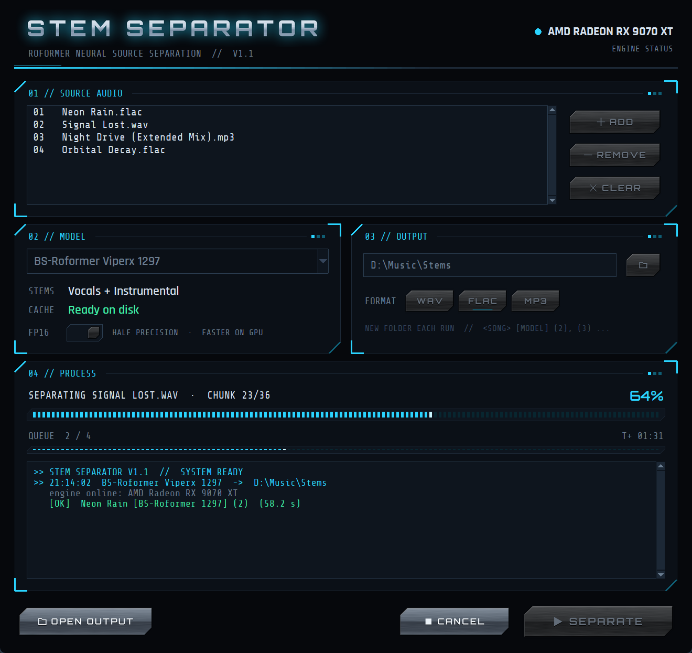

# Stem Separator

A Windows desktop app for splitting songs into stems (vocals, instrumental, drums, bass and more) with the
**BS-Roformer** and **MelBand-Roformer** models, running on your GPU. That includes **AMD Radeon cards through
ROCm on Windows**, which most stem tools don't support.



It is a small GUI on top of [audio-separator](https://github.com/nomadkaraoke/python-audio-separator), with a fix for a
ROCm attention bug that otherwise stops Roformer models from running on Radeon cards (see [ROCm notes](#rocm-notes)).

## Features
- Nine curated Roformer models: vocals/instrumental, karaoke (lead vs backing vocals), 6-stem, de-reverb and denoise
- AMD ROCm, NVIDIA CUDA, or CPU
- Queue several songs, or drag files and whole folders onto the window; output as WAV, FLAC or MP3 (320 kbps)
- Repeat runs never overwrite earlier ones, and every file is named with its model and run number, so stems from
  many runs can be used side by side
- Half-precision mode for extra speed, live progress, cancel at any time
- Models download automatically the first time you use them

## Requirements
- Windows 10 or 11, 64-bit
- [Python 3.12](https://www.python.org/downloads/) (or [uv](https://docs.astral.sh/uv/), which the installer uses when present)
- [ffmpeg](https://ffmpeg.org) on PATH (the installer offers to install it with winget)
- A supported GPU. **Tested: AMD Radeon RX 9070 XT.** The other options in the installer (RX 9060, RX 7000, RX 6000,
  Ryzen AI iGPUs, NVIDIA RTX/GTX) use the official PyTorch wheels for those cards but have not been tested with this app.
- Disk space: about 5 GB for PyTorch, plus 0.6–0.9 GB for each model you use

## Install
1. Download this repository (green **Code** button → *Download ZIP*, then extract it) or `git clone` it.
2. Double-click **`install.bat`**. It detects your graphics card, suggests the matching PyTorch build, and installs
   everything into a `.venv` folder inside the app folder. Nothing is installed system-wide.
3. Double-click **`Stem Separator.bat`** to start the app.

To skip the menu, pass the target: `install.bat amd-rx9070`, `install.bat nvidia`, `install.bat cpu`, etc.
(the keys are listed in [install.py](install.py)). To switch to a different GPU later, run `install.bat` again.

## Usage
1. **Add** one or more songs, or drag them onto the window. A dropped folder adds every audio file in it, subfolders
   included.
2. Pick a **model** and an **output** folder and format.
3. Press **Separate**.

Each song gets its own folder: `<output>/<song> [<model>]/<song> - <Stem> [<model>].<ext>`. Separating the same song
with the same model again doesn't overwrite anything: the new run goes to `<song> [<model>] (2)`, then `(3)` and so
on, and the number is added to its file names too. **Cancel** stops right away, but the stems of the song that was in
progress may be incomplete.

| Model | Stems |
|---|---|
| BS-Roformer Viperx 1297 | Vocals + Instrumental |
| MelBand Roformer Kim | Vocals + Other |
| MelBand Roformer Big Beta 6X (unwa) | Vocals + Other |
| MelBand Roformer Inst V2 (unwa) | Instrumental + Vocals |
| MelBand Roformer INSTV8 (Gabox) | Instrumental + Vocals |
| MelBand Roformer Karaoke (becruily) | Lead vocals + Backing/instrumental |
| BS-Roformer SW (jarredou) | Vocals, Drums, Bass, Guitar, Piano, Other |
| MelBand Roformer De-Reverb (anvuew) | No reverb + Reverb |
| MelBand Roformer Denoise (aufr33) | Dry + Noise |

The worker can also be used from a terminal:

```
.venv\Scripts\python.exe separate_worker.py song.mp3 --model BS-Roformer-SW.ckpt --out stems --format FLAC --fp16
```

## Speed
On an RX 9070 XT, with half precision, for a 30-second clip:

| Model | Time |
|---|---|
| BS-Roformer Viperx 1297 | ~17 s for the first song (includes ~8 s warm-up), ~9 s after that |
| MelBand Roformer Kim | ~9 s |
| BS-Roformer SW (6 stems) | ~12 s |

Add about 8 seconds per run for starting up and loading the model. Peak VRAM use was around 5 GB.

## ROCm notes
Found while getting this working on an RX 9070 XT (gfx1201) with torch 2.12.0+rocm7.14.1 on Windows:
- **The memory-efficient attention backend fails on every call** with `hipErrorInvalidValue`. The error only surfaces
  at the *next* GPU operation, so it looks like a crash in the Roformer attention gate. Flash attention has no kernel.
  [rocm_patches.py](rocm_patches.py) restricts audio-separator's attention to PyTorch's MATH backend, which works
  and gives correct results.
- hipBLASLt made no speed difference, so it is turned off (`TORCH_BLAS_PREFER_HIPBLASLT=0`) to avoid AMD's known
  GPU-reset issue on RX 9070 cards. Set the variable to `1` yourself to override.
- The ROCm build of PyTorch ships a slow CPU math library, so CPU mode in a ROCm install is impractically slow.
  Choose the CPU option in the installer if you have no supported GPU.

## Project layout
- `stem_gui.py`: the window. Runs the separation in a subprocess so Cancel can stop it instantly and free VRAM.
- `separate_worker.py`: runs audio-separator and reports progress to the GUI.
- `scifi_ui.py`: the look: metal buttons and title drawn with Pillow, HUD panels, LED progress bars.
- `rocm_patches.py`: the ROCm fixes above.
- `install.py` / `install.bat`: the installer. `requirements.txt` lists everything except PyTorch.

## Credits
- [audio-separator](https://github.com/nomadkaraoke/python-audio-separator) (MIT) does the separation and hosts the
  model files, building on the [Ultimate Vocal Remover](https://github.com/Anjok07/ultimatevocalremovergui) project.
- The models were trained by viperx, Kimberley Jensen, unwa, Gabox, becruily, jarredou, anvuew and aufr33. Check each
  model's own terms before commercial use.
- Fonts: [Orbitron](https://fonts.google.com/specimen/Orbitron), [Rajdhani](https://fonts.google.com/specimen/Rajdhani)
  and [Share Tech Mono](https://fonts.google.com/specimen/Share+Tech+Mono), under the SIL Open Font License
  (licence files in `assets/fonts`).
- Drag and drop: [tkinterdnd2](https://github.com/Eliav2/tkinterdnd2) (MIT), which bundles the tkdnd library.

## License
[MIT](LICENSE)
